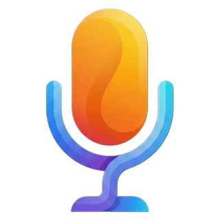

# Swift Speak

### מדברים. וזה כבר כתוב.

הקלדה קולית ל-Windows, גם בלי אינטרנט

   

&nbsp;&nbsp;

<a href="#כל-מה-שהקלדה-קולית-צריכה-להיות">יכולות</a> · <a href="#שלושה-צעדים-ומדברים">מתחילים</a> · <a href="#דרישות-ופרטים-טכניים">דרישות</a> · <a href="#שאלות-נפוצות">שאלות נפוצות</a> · <a href="#משוב-ותמיכה">תמיכה</a>

‏<a href="README.md">English</a> · <b>עברית</b>

הקלדה קולית ותמלול קבצים ל-Windows, שעובדים גם בלי אינטרנט. הטקסט מוקלד לכל חלון שבו נמצא הסמן ומופיע כבר תוך כדי הדיבור, והקלטות וסרטונים הופכים לטקסט, לכתוביות או למסמך Word.

<table dir="ltr">
<tr>
<td align="center" valign="top" width="165" dir="rtl"><h3>14</h3><b>סוגי קבצים לתמלול</b> שמע ווידאו</td>
<td align="center" valign="top" width="165" dir="rtl"><h3>100%</h3><b>עיבוד על המחשב</b> בלי שרתים ובלי ענן</td>
<td align="center" valign="top" width="165" dir="rtl"><h3>פי 65</h3><b>תמלול מהיר מזמן אמת</b> עם כרטיס מסך</td>
<td align="center" valign="top" width="165" dir="rtl"><h3>כ-100</h3><b>שפות דיבור</b> עם זיהוי אוטומטי</td>
</tr>
</table>

## כל מה שהקלדה קולית צריכה להיות.

<table>
<tr>
<td width="33%" valign="top"> <b>בכל חלון שאפשר להקליד בו</b> מסמכים, דפדפן, צ'אט או עורך קוד. הקלדה ישירה לחלון הפעיל, בלי העתק-הדבק, כולל סימנים ואמוג'י.</td>
<td width="33%" valign="top"> <b>עובד גם בלי אינטרנט</b> זיהוי הדיבור רץ על המחשב. בטיסה, ברכבת או ברשת מוגבלת.</td>
<td width="33%" valign="top"> <b>כ-100 שפות</b> זיהוי אוטומטי של השפה, ודיוק גבוה במיוחד בעברית.</td>
</tr>
<tr>
<td width="33%" valign="top"> <b>מדברים בעברית. מקבלים אנגלית.</b> בוחרים בתפריט שהטקסט יוקלד באנגלית, והתרגום קורה תוך כדי הדיבור, גם הוא על המחשב.</td>
<td width="33%" valign="top"> <b>רק דיבור הופך לטקסט</b> רעשי רקע לא נכתבים, ומשפטים שנוצרים משקט מסוננים.</td>
<td width="33%" valign="top"> <b>המונחים שלכם, כתובים נכון</b> מגדירים מראש שמות ומילים מקצועיות, וההקלדה הקולית כותבת אותם בדיוק כמו שצריך.</td>
</tr>
</table>

## שלושה צעדים, ומדברים.

מורידים את קובץ ההתקנה מ<a href="https://lifeai.ovh/swift-speak"><b>עמוד Swift Speak באתר lifeai.ovh</b></a>. כשיוצאת גרסה חדשה, התוכנה מתעדכנת בעצמה.

<table>
<tr>
<td width="33%" valign="top" align="center"><h3>1</h3><b>מתקינים</b> התקנה אחת לכל מחשב. כרטיס מסך של NVIDIA מזוהה לבד.</td>
<td width="33%" valign="top" align="center"><h3>2</h3><b>לוחצים</b> על <kbd>Ctrl</kbd> + <kbd>Alt</kbd> + <kbd>D</kbd> או על הכפתור הצף. בפעם הראשונה מורד המודל, וזה קורה רק פעם אחת.</td>
<td width="33%" valign="top" align="center"><h3>3</h3><b>מדברים</b> הטקסט מוקלד לחלון שבו נמצא הסמן. לחיצה נוספת עוצרת, או שהמיקרופון נסגר לבד אחרי שקט.</td>
</tr>
</table>

כל הגרסאות ומה השתנה בכל אחת: <a href="https://github.com/LifeAI-Dev/Swift-Speak/releases">Releases</a>.

## דרישות ופרטים טכניים.

<table>
<tr><td width="28%"><b>מערכת הפעלה</b></td><td>Windows 10 (גרסה 1809) ומעלה, או Windows 11</td></tr>
<tr><td width="28%"><b>כרטיס מסך</b></td><td>התקנה אחת לכל מחשב. עם כרטיס מסך של NVIDIA ההאצה יורדת אוטומטית</td></tr>
<tr><td width="28%"><b>שפות דיבור</b></td><td>כ-100 שפות, עם זיהוי אוטומטי ותרגום לאנגלית</td></tr>
<tr><td width="28%"><b>תמלול קבצים</b></td><td>שמע: MP3, M4A, AAC, WAV, FLAC, WMA, OGG, OPUS וידאו: MP4, MOV, MKV, WebM, AVI, WMV</td></tr>
<tr><td width="28%"><b>קובצי תמלול</b></td><td>טקסט (TXT), כתוביות (SRT, VTT) או מסמך Word, עם או בלי חותמות זמן</td></tr>
<tr><td width="28%"><b>הפעלה</b></td><td>מקש קיצור גלובלי שאפשר לשנות (ברירת המחדל <kbd>Ctrl</kbd> + <kbd>Alt</kbd> + <kbd>D</kbd>), בלחיצה או בלחיצה ממושכת</td></tr>
<tr><td width="28%"><b>שפת ממשק</b></td><td>עברית ואנגלית, עם ערכה כהה ובהירה</td></tr>
<tr><td width="28%"><b>אינטרנט</b></td><td>נדרש רק בשימוש הראשון ולבדיקת עדכונים. ההקלדה הקולית והתמלול עובדים בלי חיבור.</td></tr>
</table>

## שאלות נפוצות

<b>מה זה Swift Speak?</b>

 

‏Swift Speak היא תוכנת הקלדה קולית ל-Windows מבית LifeAi. מדברים, והטקסט מוקלד בזמן אמת לכל חלון שבו נמצא הסמן, כמו Word, דפדפן, WhatsApp או עורך קוד. היא גם מתמללת הקלטות וסרטונים לקובץ טקסט, לכתוביות או למסמך Word. זיהוי הדיבור רץ על המחשב, ולכן התוכנה עובדת גם בלי אינטרנט.

<b>איך עושים הקלדה קולית במחשב?</b>

 

עם Swift Speak מתקינים את התוכנה ב-Windows 10 או 11, מעמידים את הסמן בכל מקום שאפשר להקליד בו, לוחצים Ctrl+Alt+D ומדברים. הטקסט מופיע תוך כדי הדיבור. לוחצים שוב כדי לעצור, או מחזיקים את המקש לחוץ רק בזמן שמדברים.

<b>האם Swift Speak חינמית?</b>

 

כן. Swift Speak חינמית לשימוש אישי שאינו מסחרי. לשימוש מסחרי, למשל בעסק או בארגון, <a href="https://lifeai.ovh/contact">פנו אלינו</a> לקבלת רישיון. התנאים המלאים מופיעים בהסכם הרישיון שמצורף לתוכנה.

<b>אפשר לתמלל הקלטה או סרטון לטקסט?</b>

 

כן. ב-Swift Speak גוררים קובץ שמע או וידאו אל הכפתור הצף או לחלון "תמלול קבצים", והתמלול נשמר ליד הקובץ המקורי כקובץ טקסט, כתוביות או מסמך Word. אפשר להוסיף כמה קבצים לתור, והתמלול רץ על המחשב, גם בלי אינטרנט.

<b>איך יוצרים כתוביות לסרטון?</b>

 

ב-Swift Speak גוררים את הסרטון לחלון "תמלול קבצים" ובוחרים בפורמט SRT, או VTT לנגנים באתרים. הכתוביות נוצרות לפי הכללים המקובלים, עד שתי שורות של 42 תווים ועד 7 שניות על המסך, ובעברית הן מוצגות נכון מימין לשמאל.

<b>אילו קבצים אפשר לתמלל?</b>

 

‏Swift Speak מתמללת קובצי MP3, M4A, AAC, WAV, FLAC, WMA, OGG ו-OPUS, כולל הודעות קוליות של WhatsApp, ואת פס הקול של סרטוני MP4, MOV, MKV, WebM, AVI ו-WMV.

<b>יש תוכנת דיבור לטקסט שעובדת בלי אינטרנט?</b>

 

כן. Swift Speak ממירה דיבור לטקסט על המחשב עצמו, בלי לשלוח את ההקלטות לשרת, ולכן היא עובדת גם במצב לא מקוון. היא רצה על כל מחשב, ועם כרטיס מסך של NVIDIA היא מהירה עוד יותר.

<b>האם ההקלטות שלי נשלחות לאינטרנט?</b>

 

לא. Swift Speak מזהה את הדיבור על המחשב עצמו, ולכן ההקלדה הקולית ותמלול הקבצים עובדים גם בלי חיבור לאינטרנט. התוכנה מתחברת לרשת רק בשימוש הראשון, להורדת הרכיבים, ולבדיקת עדכונים. הפרטים המלאים ב<a href="https://lifeai.ovh/privacy">מדיניות הפרטיות</a>.

<b>צריך כרטיס מסך חזק?</b>

 

לא חובה. Swift Speak רצה על המעבד ועובדת מצוין על כל מחשב, אבל ייתכן שתורגש השהיה קלה עד שהטקסט מופיע. כשיש כרטיס מסך של NVIDIA, התוכנה מזהה אותו ומורידה לבד את רכיב ההאצה, והטקסט מופיע כמעט מיד.

<b>באילו תוכנות זה עובד?</b>

 

‏Swift Speak מקלידה בכל חלון שאפשר להקליד בו: Word, Outlook, דפדפנים, WhatsApp, Slack, VS Code ועוד. אם חלון מסוים לא מאפשר הקלדה ישירה, הטקסט מועתק ללוח ומוצגת התראה.

<b>כמה שפות Swift Speak תומכת?</b>

 

‏Swift Speak תומכת בכ-100 שפות, עם זיהוי שפה אוטומטי. אפשר גם לדבר בכל שפה ולקבל את הטקסט מוקלד באנגלית, בתרגום שמתבצע תוך כדי הדיבור.

<b>כמה טובה ההקלדה הקולית בעברית?</b>

 

מצוינת. Swift Speak כולל זיהוי דיבור שמותאם במיוחד לעברית, ואפשר להגדיר מראש שמות ומונחים שחוזרים אצלכם, כדי שייכתבו נכון.

<b>אפשר לדבר בעברית ולקבל טקסט באנגלית?</b>

 

כן. ב-Swift Speak בוחרים בתפריט שהטקסט יוקלד באנגלית, ומדברים בכל שפה. התרגום מתבצע תוך כדי התמלול, גם הוא על המחשב.

<b>מה קורה אם מישהו אחר מדבר לידי?</b>

 

כשהאפשרות "התעלם מדוברים אחרים" פעילה, Swift Speak מזהה את הקול שלכם ומדלגת על משפטים של אנשים אחרים. לא נשמר שום פרופיל קולי.

<b>האם Swift Speak עובדת על Mac?</b>

 

כרגע Swift Speak זמינה ל-Windows 10 (גרסה 1809 ומעלה) ול-Windows 11 בלבד.

## על המאגר הזה

במאגר הזה מתפרסמים קובצי ההתקנה של Swift Speak. כל גרסה מופיעה תחת <a href="https://github.com/LifeAI-Dev/Swift-Speak/releases">Releases</a> עם קובץ ההתקנה שלה, וכפתור ההורדה באתר <a href="https://lifeai.ovh/swift-speak">lifeai.ovh</a> מוביל תמיד לגרסה החדשה ביותר. קוד המקור של התוכנה לא נמצא כאן.

## משוב ותמיכה

<table>
<tr>
<td width="33%" valign="top"> <b>מצאתם תקלה?</b> <a href="https://github.com/LifeAI-Dev/Swift-Speak/issues/new?template=bug_report.yml">פתחו דיווח על תקלה</a></td>
<td width="33%" valign="top"> <b>יש לכם רעיון?</b> <a href="https://github.com/LifeAI-Dev/Swift-Speak/issues/new?template=feature_request.yml">הציעו יכולת חדשה</a></td>
<td width="33%" valign="top"> <b>כל דבר אחר</b> כתבו לנו: <a href="mailto:contact@lifeai.ovh">contact@lifeai.ovh</a></td>
</tr>
</table>

## רישיון

‏Swift Speak חינמית לשימוש אישי שאינו מסחרי. לשימוש מסחרי, למשל בעסק או בארגון, <a href="https://lifeai.ovh/contact">פנו אלינו</a> לקבלת רישיון. התנאים המלאים מופיעים בהסכם הרישיון שמצורף לתוכנה.

<a href="https://lifeai.ovh/terms">תנאי שימוש</a> · <a href="https://lifeai.ovh/privacy">מדיניות פרטיות</a>

## עוד מבית LifeAi

<table>
<tr><td width="64" align="center"></td><td><b>Snap Translate</b> תרגום מסך ומסמכים ל-Windows</td><td><a href="https://lifeai.ovh/snap-translate">לאתר</a></td></tr>
<tr><td width="64" align="center"></td><td><b>SearchAble</b> חיפוש קבצים במחשב לפי תוכן ומשמעות</td><td><a href="https://lifeai.ovh/searchable">לאתר</a></td></tr>
<tr><td width="64" align="center"></td><td><b>DriveLog</b> יומן וסוכן קולי למורי נהיגה</td><td>בקרוב · <a href="https://lifeai.ovh/drivelog">לאתר</a></td></tr>
</table>

 

 

<picture><source media="(prefers-color-scheme: dark)" srcset="assets/lifeai-dark.png"></picture>

נבנה על ידי <a href="https://lifeai.ovh/"><b>LifeAi</b></a> · מוצרי תוכנה ובינה מלאכותית

