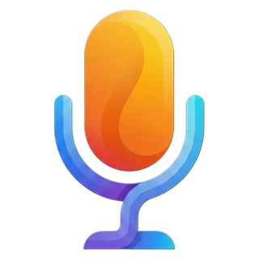

# Swift Speak

### You speak. Already written.

Voice typing for Windows, even offline

   

&nbsp;&nbsp;

<a href="#everything-voice-typing-should-be">Features</a> · <a href="#three-steps-then-talk">Get started</a> · <a href="#requirements-and-details">Requirements</a> · <a href="#faq">FAQ</a> · <a href="#feedback-and-support">Support</a>

<b>English</b> · <a href="README.he.md">עברית</a>

Voice typing and file transcription for Windows that work even offline. The text is typed into whichever window has your cursor and appears while you're still speaking, and recordings and videos become text, subtitles or a Word document.

<table>
<tr>
<td align="center" valign="top" width="165"><h3>&#126;100</h3><b>Speech languages</b> With automatic detection</td>
<td align="center" valign="top" width="165"><h3>65×</h3><b>Faster than real time</b> With a graphics card</td>
<td align="center" valign="top" width="165"><h3>100%</h3><b>On-device processing</b> No servers, no cloud</td>
<td align="center" valign="top" width="165"><h3>14</h3><b>File types to transcribe</b> Audio and video</td>
</tr>
</table>

## Everything voice typing should be.

<table>
<tr>
<td width="33%" valign="top"> <b>In any window you can type in</b> Documents, browser, chat or code editor. Typing goes straight into the active window, with no copy and paste, including symbols and emoji.</td>
<td width="33%" valign="top"> <b>Works offline too</b> Speech recognition runs on your computer. On a plane, on a train or on a limited network.</td>
<td width="33%" valign="top"> <b>&#126;100 languages</b> Automatic language detection, plus a model tuned especially for Hebrew.</td>
</tr>
<tr>
<td width="33%" valign="top"> <b>Speak any language. Get English.</b> Choose in the menu to have the text typed in English, and the translation happens while you speak, also on your computer.</td>
<td width="33%" valign="top"> <b>Speech only</b> Background noise isn't written, and sentences made up out of silence are filtered out.</td>
<td width="33%" valign="top"> <b>Your terms, spelled right</b> Define names and professional terms in advance, and voice typing writes them exactly right.</td>
</tr>
</table>

## Three steps, then talk.

Download the installer from the <a href="https://lifeai.ovh/en/swift-speak"><b>Swift Speak page on lifeai.ovh</b></a>. When a new version comes out, the app updates itself.

<table>
<tr>
<td width="33%" valign="top" align="center"><h3>1</h3><b>Install</b> One installer for every PC. An NVIDIA graphics card is detected automatically.</td>
<td width="33%" valign="top" align="center"><h3>2</h3><b>Press</b> <kbd>Ctrl</kbd> + <kbd>Alt</kbd> + <kbd>D</kbd> or the floating button. The first time, the model downloads, and that happens only once.</td>
<td width="33%" valign="top" align="center"><h3>3</h3><b>Speak</b> The text is typed into the window where your cursor is. Press again to stop, or the microphone closes by itself after a silence.</td>
</tr>
</table>

All versions and what changed in each: <a href="https://github.com/LifeAI-Dev/Swift-Speak/releases">Releases</a>.

## Requirements and details.

<table>
<tr><td width="28%"><b>Operating system</b></td><td>Windows 10 (version 1809) or later, or Windows 11</td></tr>
<tr><td width="28%"><b>Graphics card</b></td><td>One installer for every PC. With an NVIDIA graphics card, acceleration downloads automatically</td></tr>
<tr><td width="28%"><b>Speech languages</b></td><td>About 100 languages, with automatic detection and translation into English</td></tr>
<tr><td width="28%"><b>File transcription</b></td><td>Audio: MP3, M4A, AAC, WAV, FLAC, WMA, OGG, OPUS Video: MP4, MOV, MKV, WebM, AVI, WMV</td></tr>
<tr><td width="28%"><b>Transcript files</b></td><td>Text (TXT), subtitles (SRT, VTT) or a Word document, with or without timestamps</td></tr>
<tr><td width="28%"><b>Activation</b></td><td>A global shortcut you can change (default <kbd>Ctrl</kbd> + <kbd>Alt</kbd> + <kbd>D</kbd>), by pressing or holding</td></tr>
<tr><td width="28%"><b>Interface language</b></td><td>English and Hebrew, with dark and light themes</td></tr>
<tr><td width="28%"><b>Internet</b></td><td>Needed only on first use and to check for updates. Voice typing and transcription work offline.</td></tr>
</table>

## FAQ

<b>What is Swift Speak?</b>

 

Swift Speak is voice typing software for Windows from LifeAi. You speak, and the text is typed in real time into whichever window has your cursor, such as Word, a browser, WhatsApp or a code editor. It also transcribes recordings and videos into a text file, subtitles or a Word document. Speech recognition runs on your computer, so it works even without an internet connection.

<b>How do I use voice typing on my PC?</b>

 

Install Swift Speak on Windows 10 or 11, put your cursor anywhere you can type, press Ctrl+Alt+D and speak. The text appears as you talk. Press again to stop, or hold the key down only while you speak.

<b>Is Swift Speak free?</b>

 

Yes. Swift Speak is free for personal, non-commercial use. For commercial use, for example in a business or an organization, <a href="https://lifeai.ovh/en/contact">contact us</a> for a license. The full terms are in the license agreement that comes with the software.

<b>Can I transcribe a recording or a video to text?</b>

 

Yes. In Swift Speak, drag an audio or video file onto the floating button or into the "File transcription" window, and the transcript is saved next to the original file as a text file, subtitles or a Word document. You can add several files to the queue, and transcription runs on your computer, even offline.

<b>How do I create subtitles for a video?</b>

 

In Swift Speak, drag the video into the "File transcription" window and choose the SRT format, or VTT for web players. The subtitles follow the standard rules, up to two lines of 42 characters and up to 7 seconds on screen, and right-to-left languages such as Hebrew are displayed correctly.

<b>Which files can I transcribe?</b>

 

Swift Speak transcribes MP3, M4A, AAC, WAV, FLAC, WMA, OGG and OPUS files, including WhatsApp voice messages, and the soundtrack of MP4, MOV, MKV, WebM, AVI and WMV videos.

<b>Is there speech-to-text software that works offline?</b>

 

Yes. Swift Speak converts speech to text on the computer itself, without sending your recordings to a server, so it also works offline. It runs on any PC, and even faster with an NVIDIA graphics card.

<b>Are my recordings sent over the internet?</b>

 

No. Swift Speak recognizes speech on the computer itself, so voice typing and file transcription work even without an internet connection. The software connects to the network only on first use, to download its components, and to check for updates. The full details are in the <a href="https://lifeai.ovh/en/privacy">privacy policy</a>.

<b>Do I need a powerful graphics card?</b>

 

Not necessarily. Swift Speak runs on the processor and works great on any computer, though you may notice a slight delay before the text appears. When there is an NVIDIA graphics card, the software detects it and downloads the acceleration component by itself, and the text appears almost instantly.

<b>Which apps does it work with?</b>

 

Swift Speak types into any window you can type in: Word, Outlook, browsers, WhatsApp, Slack, VS Code and more. If a window doesn't accept direct typing, the text is copied to the clipboard and a notification appears.

<b>How many languages does Swift Speak support?</b>

 

Swift Speak supports about 100 languages, with automatic language detection. You can also speak in any language and have the text typed in English, translated while you speak.

<b>How accurate is the voice typing?</b>

 

Very accurate. Swift Speak recognizes about 100 languages, with a model tuned especially for Hebrew, and you can define in advance names and terms you use often, so they're written correctly.

<b>Can I speak another language and get English text?</b>

 

Yes. In Swift Speak, choose in the menu to have the text typed in English, and speak in any language. The translation happens during transcription, also on your computer.

<b>What happens if someone else is talking near me?</b>

 

When the "Ignore other speakers" option is on, Swift Speak recognizes your voice and skips sentences from other people. No voice profile is saved.

<b>Does Swift Speak work on a Mac?</b>

 

For now, Swift Speak is available only for Windows 10 (version 1809 or later) and Windows 11.

## About this repository

This repository is where the installers of Swift Speak are published. Every version appears under <a href="https://github.com/LifeAI-Dev/Swift-Speak/releases">Releases</a> with its installer, and the download button on <a href="https://lifeai.ovh/en/swift-speak">lifeai.ovh</a> always leads to the newest one. The source code of the app is not hosted here.

## Feedback and support

<table>
<tr>
<td width="33%" valign="top"> <b>Found a bug?</b> <a href="https://github.com/LifeAI-Dev/Swift-Speak/issues/new?template=bug_report.yml">Open a bug report</a></td>
<td width="33%" valign="top"> <b>Have an idea?</b> <a href="https://github.com/LifeAI-Dev/Swift-Speak/issues/new?template=feature_request.yml">Suggest a feature</a></td>
<td width="33%" valign="top"> <b>Anything else?</b> Write to <a href="mailto:contact@lifeai.ovh">contact@lifeai.ovh</a></td>
</tr>
</table>

## License

Swift Speak is free for personal, non-commercial use. For commercial use, for example in a business or an organization, <a href="https://lifeai.ovh/en/contact">contact us</a> for a license. The full terms are in the license agreement that comes with the software.

<a href="https://lifeai.ovh/en/terms">Terms of use</a> · <a href="https://lifeai.ovh/en/privacy">Privacy policy</a>

## More from LifeAi

<table>
<tr><td width="64" align="center"></td><td><b>Snap Translate</b> Screen translator for Windows</td><td><a href="https://lifeai.ovh/en/snap-translate">Website</a></td></tr>
<tr><td width="64" align="center"></td><td><b>SearchAble</b> Local AI file search for Windows</td><td><a href="https://lifeai.ovh/en/searchable">Website</a></td></tr>
<tr><td width="64" align="center"></td><td><b>DriveLog</b> Calendar and voice agent for driving instructors</td><td>Coming soon · <a href="https://lifeai.ovh/en/drivelog">Website</a></td></tr>
</table>

 

 

<picture><source media="(prefers-color-scheme: dark)" srcset="assets/lifeai-dark.png"></picture>

Made by <a href="https://lifeai.ovh/en/"><b>LifeAi</b></a> · AI-powered software products

